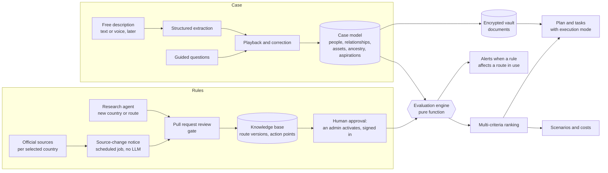

# Architecture

As of 2026-11-02. Stack: [ADR-0010](adr/0010-stack-revised.md).

## Overview

The center of Arca is the **evaluation engine**: it crosses a versioned catalog of routes with a structured model of the case. Rules are data with a source and a verification date, not code ([ADR-0002](adr/0002-rules-as-versioned-data.md)). AI agents sit around that core to understand the family, explain, write and research; they never decide eligibility.



No job changes a rule on its own: an update request proposes, a person approves with a passkey, and the engine re-evaluates routes in use; the source-change notice only tells admins ([ADR-0031](adr/0031-rule-updates-on-request.md)). The one other way in is a session review the owner asks for: a reviewed pull request whose generated migration stores the next version of a stored route, already active ([ADR-0032](adr/0032-session-reviews-activate-through-a-reviewed-pull-request.md)). Until the import moves them into insert-only database rows, route versions are JSON files in `packages/knowledge`, reviewed as pull requests and immutable once merged; a version stays proposed until an admin activates it in the app ([ADR-0027](adr/0027-admins-and-the-checked-batch-activation.md), [ADR-0014](adr/0014-knowledge-base-as-reviewed-data.md), [spec 0002](specs/0002-rules-engine-and-knowledge-base.md)).

## Platforms and code layout

One client serves every platform ([ADR-0005](adr/0005-platform-strategy.md)): a TypeScript single-page app that builds to a static bundle, wrapped by Capacitor on Android and iOS and by Tauri on desktop.

```text
apps/
  api/          versioned HTTP API (/v1), the only door to data and AI; background
                workflows (Vercel Workflows) live in api/src/workflows
  web/          the client: React SPA, installable PWA
  mobile/       Capacitor project wrapping apps/web (Phase 4 Android, Phase 5 iOS and iPadOS)
  desktop/      Tauri project wrapping apps/web (Phase 6, only if its gate passes)
packages/
  domain/       case model, evaluation engine, unit computation, ranking; pure TypeScript, no I/O
  api-contract/ Zod route definitions, OpenAPI export and the typed client derived from them
  ui/           components and design tokens
  i18n/         message catalogs (pt-BR first)
  platform/     capability ports and their adapters (web, capacitor, tauri)
  db/           Drizzle schema and migrations, role SQL, the runtime role pool and request identity,
                the personal-data registry and the synthetic seed
  knowledge/    the knowledge base as data: route versions and their cases, country sets, official-domain
                lists, the countries files, and the country indicators and comparison versions of the
                destination comparison; validated and hashed; route versions, country sets and official-domain
                lists were imported once into the database, which the API reads, and the rest is bundled
                into the API ([ADR-0014](adr/0014-knowledge-base-as-reviewed-data.md), [ADR-0031](adr/0031-rule-updates-on-request.md),
                [ADR-0026](adr/0026-destination-comparison-data.md))
  telemetry/    the one scrubber every log, error, trace and LLM-trace exporter uses (ADR-0016)
  vault/        client-side document encryption in the age format (ADR-0018); never used by the API
tooling/        shared ESLint and TypeScript configs, security header policy, repository scripts
                (dependency-source, boundary and bundle checks, CI policy scripts, migration runner)
eval/           evaluation corpora shared across packages: the synthetic families in families/ (spec 0002);
                an AI evaluation lives next to the adapter it scores, such as apps/api/test/eval/intake
```

Rules that keep every platform possible:

- **No business logic in the client.** The client renders, collects input and calls the API. Domain logic lives in `packages/domain` and runs on the server. The one exception is end-to-end cryptography in `packages/vault` (encryption, sharing-state verification, recipient selection), which must run on the device; it holds no domain rules.
- **No server-rendering dependency.** The client must work as static files inside a native wrapper.
- **Native features only through `packages/platform`.** Ports for passkeys (and sealing or opening vault envelopes with them), camera and document scanning, secure key storage, notifications, file picking, sharing and deep links. Each runtime has an adapter; UI code checks capabilities, never the operating system. On the web, printing, downloads and copying text to the clipboard use the standard browser APIs and have no port; each native phase checks them in its webview and adds a `platform` port where one falls short.
- **One identity across platforms.** Passkeys use the production host as relying-party ID from day one (`arca.filx.app`; [ADR-0015](adr/0015-identity-enrollment-step-up-and-recovery.md)). Native apps call the platform passkey APIs through the `platform` port (not WebAuthn in the WebView) and are linked to the domain through `/.well-known/assetlinks.json` (Android) and `/.well-known/apple-app-site-association` with the `webcredentials` entitlement (iOS) ([web.dev](https://web.dev/articles/webauthn-rp-id), [ADR-0006](adr/0006-auth.md)).
- **Same URLs everywhere.** Deep links (App Links, Universal Links) map to the web app's paths.
- **Portable encryption.** The vault format is standard and documented; native keystores later wrap the same per-person vault identities ([ADR-0018](adr/0018-vault-encryption.md)).

| Capability port | Web adapter | Android adapter | iOS adapter | Desktop adapter |
| --- | --- | --- | --- | --- |
| Document capture | Camera capture and file input | ML Kit document scanner | VisionKit document scanner | File picker |
| Key storage | WebCrypto non-extractable keys | Android Keystore | Keychain and Secure Enclave | OS keychain |
| Notifications | Web Push | FCM | APNs | OS notifications |
| Receive shared files | Web Share Target (where supported) | Share-sheet intent | Share extension | Drag and drop |
| Deep links | URLs | App Links | Universal Links | Custom protocol |
| File picking | `<input type=file>` | Storage Access Framework | Document picker | OS file dialog |
| Sharing | Web Share API | Share sheet | Share sheet | OS share where available |
| Passkeys | WebAuthn | Credential Manager | Authentication Services | OS passkey APIs where available |
| Vault envelopes (passkey PRF, user-verified, biometric where the platform offers it) | WebAuthn PRF through `age-encryption` | Credential Manager PRF supplied to the same `age-encryption` code in the app's JavaScript runtime, else the recovery kit with the identity wrapped in Android Keystore | Authentication Services PRF supplied the same way, else the recovery kit with the identity wrapped in the Keychain | OS support where available, else the recovery kit |

Each port has one conformance suite in `packages/platform/src/conformance`, written once ([spec 0005](specs/0005-vault-devices-and-notifications.md#r5-platform-port-and-web-adapters) R5). Vitest runs every suite against in-memory fakes. Playwright runs it against the web adapters in Chromium, with pages served from the built package by request interception. A later Capacitor or Tauri adapter must pass the same suites.

- A port method called while its capability is missing rejects with `CapabilityUnavailableError`.
- `Capabilities.whyUnavailable()` says why a capability is missing: `unsupported`, or `needs-install` for web push before the app is installed.
- On the web, receiving shared files stays unavailable until the web app manifest declares a `share_target`.

## Data model

Entities, not final schema:

- `case`, `person`, `relationship`: the case as a graph of people and relationships (marriage, divorce, common-law union, parenthood, custody). Units are computed per route, not stored.
- `aspiration`: priorities, deal-breakers, budget, timeline, risk tolerance and preferred execution mode, per person.
- `country`, `destination_choice`: catalog countries and the ones each person selected, with priority and the stay-together constraint.
- `ancestor`: parents and grandparents with country, dates, naturalization and certificates.
- `route`, `route_version`: routes per country; declarative requirements, costs, dependents covered, `sources` (URL, kind, `verifiedAt`), effective dates, pinned country sets and official-domain lists. Insert-only rows in the `knowledge` schema (`route_version`, `country_set`, `official_domain_list`), imported once with their hashes from the files `packages/knowledge` held, then added by update requests: a proposed version, and a new country's first official-domain list, decided apart as the `official_domains` decision subject ([ADR-0014](adr/0014-knowledge-base-as-reviewed-data.md), [ADR-0031](adr/0031-rule-updates-on-request.md)); the API recomputes each hash on read and withholds a route with a failing row; admins' decisions on them are stored in `knowledge.decision` (spec 0007 R7, ADR-0027), and who held the admin role when in `knowledge.admin_grant`, insert-only with account IDs only.
- `country_indicator`, `comparison_version`: country data for the destination comparison and the criteria that read it. Files in `packages/knowledge`, activated as a whole; their decisions sit in `knowledge.decision` under the subject kind `comparison` ([ADR-0026](adr/0026-destination-comparison-data.md)).
- `comparison_preferences`: one adult's weights, ratings, own criteria and hidden countries, one JSON row per case member, private to its account ([ADR-0026](adr/0026-destination-comparison-data.md)).
- `action_point`: where each step happens (official link, phone, consulate by jurisdiction, partner by region).
- `evaluation`: person or unit × route version → status, missing requirements, estimated cost and time.
- `asset`, `sale`, `gift`, `fx_transfer`: the source-of-funds trail.
- `plan`, `task`, `task_dependency`: the executable plan, with the execution mode of each task.
- `document`: type, owner, validity, apostille, translation and a pointer to the encrypted file.
- `update_request`, `update_stage` and `update_end`: a request to refresh one route or add one, its stages with their token usage and web searches, and the proposal or failure code it ended with; one live per route, or per country for a new route. `rule_verdict` caches the validator's answer per item, quote, page text hash, validator model and prompt version, kept across requests ([ADR-0031](adr/0031-rule-updates-on-request.md)).
- `ai_key` and `ai_stage_setting` (in the `knowledge` schema): the AI provider keys (Anthropic and TypeSafe), encrypted, in insert-only rows that `app_auth` writes only behind an `ai_key` step-up, and the model and effort per update stage in insert-only rows written through a definer function; admin-only ([ADR-0031](adr/0031-rule-updates-on-request.md)). The source-change notice switch joins them with [#464](https://github.com/fernandolisboa/arca/issues/464).
- `contact`: external contacts. Proposals come from update requests, activated or rejected by an admin (ADR-0031).
- `knowledge_item`: requirement, document, step, form, fee, deadline, common pitfall or interview question, each with source and verification date. Whether these and `action_point` are files like route versions is decided in consultancy core slice 5 (ADR-0014).

## Agents

Specialized agents work on the knowledge base and the case model:

| Agent | Responsibility |
| --- | --- |
| Consultant | Diagnosis, destination comparison, recommendation with pros and cons |
| Document specialist | Personalized checklist and review of each uploaded file |
| Writer | Cover letters, business plans, source-of-funds statements |
| Interviewer | Voice simulation of consular interviews |
| Watcher | The optional source-change notice: hashes the official pages active versions cite and tells admins which routes changed; no model ([ADR-0031](adr/0031-rule-updates-on-request.md)) |
| Research agent | The research and correction stages of an update request: proposes a route version from official sources with Anthropic's web search and fetch tools, restricted to official domains; a second model validates it item by item, and the request ends after at most two rounds ([ADR-0031](adr/0031-rule-updates-on-request.md)) |
| Concierge | Arrival and settling in the destination |

Each agent gets only the tools its task needs, set in its definition. An update request's research and correction stages get only Anthropic's web search and fetch server tools, limited to approved official-domain lists, and answer in the rule schema; they hold no case data, no shell, no code execution (the tool versions without dynamic filtering) and no write path: the pipeline's code checks and stores their answer as a proposal, and only an admin decides ([ADR-0031](adr/0031-rule-updates-on-request.md)). The source-change notice uses no model.

**Golden rule:** no agent states a requirement that is not in the knowledge base with a source. When the base does not cover a question, the agent says it does not know and opens a research task, which enters the base only after human approval.

## AI stack

Each problem gets the right technique; an LLM never decides on its own what a rule is. Providers sit behind ports ([ADR-0004](adr/0004-ai-providers-behind-ports.md)).

| Kind of AI | Used for |
| --- | --- |
| Conversational LLM (Claude) | Explanations, guides, writing, on-call questions |
| Summarization (LLM with schema output) | A rule version summarized for an admin, as an aid to review that never decides ([ADR-0025](adr/0025-rule-summary-for-the-approver.md)) |
| Structured extraction (LLM with schema output) | Turning the free description into a draft of the case model ([spec 0008](specs/0008-free-text-intake.md)); detecting what is missing |
| Deterministic rules engine | Eligibility and unit computation, auditable and testable |
| Retrieval with citations (RAG) | Answering from the knowledge base, always with a source |
| Multi-criteria optimization | Ranking route and country combinations by each person's weights and the family's constraints |
| Agents with web search | An update request's research stage: Anthropic's web search and fetch server tools restricted to a route's official domains, answering in the rule schema; quotes then checked in code ([ADR-0031](adr/0031-rule-updates-on-request.md)) |
| Vision and OCR | Reading and checking uploaded documents |
| Speech | Spoken intake and interview simulation |
| Decision model (for example, TypeSafe Jev) | Choosing execution mode, triaging complications, classifying message intent and document type, cheap judge in the evaluation suite. Never rules, dates or arithmetic. Receives minimal fields only |
| Model routing | Fast, cheap models for extraction and classification; strong models for strategy |

## Quality

Quality is measured, not assumed. A suite of **synthetic cases** covers families of varied shapes (single person, couple with young children, divorced parents with shared custody, dependent elderly parents, previous visa refusal, assets held by an ex-spouse, the shape of case 1), each with a reviewed expected outcome: units per route, top recommendations, required documents and execution modes.

Rule cases run in CI on every change. An AI evaluation calls the real model, so it runs by hand from a manual workflow, never as a required check ([ADR-0019](adr/0019-reviewers-in-the-authoring-session.md)): the authoring session starts it on every change to a prompt, model, adapter, draft schema or summary schema, and the change lands only if the scores hold against the committed baseline. An adapter reaches production only after passing runs, as the [real-data gate](runbooks/real-data-gate.md) asks (free-text intake: [spec 0008, R5](specs/0008-free-text-intake.md#r5-evaluation); rule summary: [ADR-0025](adr/0025-rule-summary-for-the-approver.md)). Classifier outputs are scored on accuracy and calibration.

## Security

- Passwordless login (passkeys), invite-only, with purpose-bound step-up for sensitive and financial actions and a user-verified passkey ceremony to open the vault ([ADR-0015](adr/0015-identity-enrollment-step-up-and-recovery.md)); giving the admin role needs a step-up, and so, again since [ADR-0031](adr/0031-rule-updates-on-request.md), does activating or rejecting a knowledge-base version (from ADR-0027 until then, a signed-in admin decided without one)).
- Row-level security on every table with case data, scoped by account and then by case membership (ADR-0008, ADR-0015). A person's profile and finances are visible only to their keeper and to the members the keeper shared them with ([spec 0007](specs/0007-case-model-and-guided-intake.md#r1-case-tables)).
- Client-side encryption for documents in the age format: each person has a hybrid post-quantum identity, kept on the server only inside envelopes their passkeys or recovery kit open; each document is encrypted to its owner and the people it is shared with; storage holds ciphertext ([ADR-0018](adr/0018-vault-encryption.md)). Trade-off: AI extraction runs only when the user opens a document and authorizes it.
- Two-person approval to change bank or exchange details.
- Append-only audit log of who viewed and changed what.
- No personal data in logs, URLs or error tracking; Neon's point-in-time restore as the backup ([ADR-0021](adr/0021-stay-on-vercel-and-neon.md)); retention per data type in [RETENTION.md](RETENTION.md).
- Data minimization in every third-party AI adapter.

## Data flows

Every service that touches Arca's data, and what it may receive. A new processor, or a new kind of data sent to an existing one, needs an update here and a security review.

| Service | Role | Receives | Location |
| --- | --- | --- | --- |
| GitHub (public repository) | Source, docs and knowledge data | Code and public rules ([ADR-0014](adr/0014-knowledge-base-as-reviewed-data.md)), until rules move to the database ([ADR-0031](adr/0031-rule-updates-on-request.md)); no case data. Actions holds one secret, the evaluation's Anthropic key | Public |
| World Bank API (`api.worldbank.org`) | Destination-comparison indicators, read by a maintainer's script, never by the app ([ADR-0026](adr/0026-destination-comparison-data.md)) | The public country codes of the route catalog; no case data | World Bank (United States) |
| Official sources cited by route versions | Pages an update request's code checks read to verify each quote (for a new country, on the hosts the admin named and their subdomains; and the registry pages that prove a first official-domain list, on a named host or an imported list's host), and the one page an admin's hand edit cites, read while the API answers the edit, and the source-change notice hashes when an admin turns it on ([ADR-0031](adr/0031-rule-updates-on-request.md)) | A request for a public URL from Vercel's addresses: no cookies, credentials or case data. Rule audits also read these hosts from an authoring session ([runbook](runbooks/rule-audit.md)) | Each government's hosting |
| Web search and lead pages | Rule audits look for amendments and particular cases from an authoring session ([runbook](runbooks/rule-audit.md)); from the app, only an update request's research, through Anthropic's server tools (row below, [ADR-0031](adr/0031-rule-updates-on-request.md)) | Public search terms and public URLs only; no case data | The search provider's and each site's hosting |
| Neon (Postgres) | Primary database | All case data, under forced row-level security; public rule data (route versions, country sets, official-domain lists, proposals and their stage results), update requests (a member's note is personal data, under row-level security and in the personal-data registry) and the AI provider keys (Anthropic and TypeSafe), encrypted with AES-256-GCM under a key-encryption key that lives only in Vercel ([ADR-0031](adr/0031-rule-updates-on-request.md)) | São Paulo (`sa-east-1`) |
| Vercel | Client hosting, API functions, Workflows | All case data in processing; the database owner connection string (used by the build, readable by running functions) and the runtime role passwords ([ADR-0012](adr/0012-automation-first-setup.md)); the key-encryption key for the stored AI provider keys, a Sensitive variable ([ADR-0031](adr/0031-rule-updates-on-request.md)); workflow run payloads holding identifiers only, with zero retention ([ADR-0009](adr/0009-background-jobs-guarantees.md)) | São Paulo (`gru1`) for functions, run payloads and queues; run metadata (names, statuses, timestamps, no personal data) is processed outside Brazil and kept up to one year |
| Vercel Blob (private store) | Document storage ([ADR-0021](adr/0021-stay-on-vercel-and-neon.md)); files attached to correction requests ([ADR-0029](adr/0029-correction-requests-and-the-corrector-session.md)), and to update requests by admins or members, with the same checks and retention, never sent to a model ([ADR-0031](adr/0031-rule-updates-on-request.md)) | Client-side ciphertext only, under random pathnames; and, under `corrections/`, the owner's plaintext copies of official texts, erased 30 days after an admin closes their request, otherwise 180 days after it was filed; uploads no request names go after 24 hours | São Paulo |
| Anthropic (Claude) | LLM calls | Minimal fields per call; no names, document numbers or account numbers. Exception ([ADR-0023](adr/0023-free-text-intake-sends-the-writers-own-words.md)): free-text intake sends the member's own description, with known names, digit runs, mixed letter-and-digit tokens, e-mails and phone numbers masked; Arca stores nothing of it. The rule summary sends one version's content, public rule data with no case data, and Arca stores the plain-text reply in `knowledge.rule_summary` ([ADR-0025](adr/0025-rule-summary-for-the-approver.md)). The manual `intake-eval` workflow also calls it from GitHub Actions, with synthetic texts and the bundled rule versions only, and a key of its own. An update request ([ADR-0031](adr/0031-rule-updates-on-request.md)) sends, for research and correction, the instructions as system text and, as data in the user turn, the route's ID, its official hosts, its current version and that version's synthetic rule cases, or, for a new route, the country, the visa or entry type the admin typed (screened for digit runs and e-mails), the admin's links on those hosts, the lists it may pin and the ID of the first list to propose, and gets back the first official-domain list too; for correction also the whole proposal it corrects, the problems code found in it and the rejected items with their reasons; all public with no case data; Arca stores the proposal and each stage's token usage. Validation runs on TypeSafe (below). Once AI settings hold a key, every Anthropic call (intake, the rule summary and update requests) uses it, the owner's Console key, so usage draws on his plan's API credit, never the claude.ai subscription login. Except for an update request, whose stages cache the instructions and the route's data for five minutes so the correction reads them again, of each call Anthropic's prompt cache keeps only Arca's own instructions, until an hour after their last use ([ADR-0004](adr/0004-ai-providers-behind-ports.md); [prompt caching](https://platform.claude.com/docs/en/build-with-claude/prompt-caching), read 2026-11-11); outside an update request, nothing a call sends about a rule or a page is marked for it, and nothing about a person ever is. Anthropic's API terms (read 2026-11-06): no training on API data by default ([Commercial Terms](https://www.anthropic.com/legal/commercial-terms) §B; [privacy center](https://privacy.claude.com/en/articles/7996868)); inputs and outputs deleted within 30 days, except content flagged for a usage-policy breach (up to 2 years), trust-and-safety scores (up to 7 years), feedback the account sends, or a legal hold ([retention](https://privacy.claude.com/en/articles/7996866)) | Vendor cloud, outside Brazil; the terms name no region |
| Anthropic web search and web fetch (server tools) | An update request's research and correction stages search and read official pages from Anthropic's infrastructure ([ADR-0031](adr/0031-rule-updates-on-request.md)) | Search queries and URLs the model writes, restricted to the route's approved official-domain list (for a new country, the hosts the admin named); the instructions and the route's public data; no case data. Each fetched page adds at most 30,000 tokens. The pages read come back to the model and to Arca, and code verifies every quote against its own fetch | Anthropic cloud and its search provider, outside Brazil |
| Document-reading vendor (`DocumentReader`) | OCR and document review | Full content of a document, only when its owner authorizes that document | Chosen by ADR; vendor cloud |
| Embedding vendor (`Embedder`) | Knowledge-base retrieval | Public knowledge-base text only | Chosen by ADR |
| Speech vendor (`SpeechToText`, `TextToSpeech`) | Voice intake and interview practice | Audio of the person speaking, only when they start a voice session | Chosen by ADR |
| TypeSafe (Jev) | An update request's validation stage ([ADR-0031](adr/0031-rule-updates-on-request.md#typesafe-jev-validates-amendment-2026-11-16)); the settings' key test | Validation: each item of a proposed version with its quote, already verified in code on the official page, as public rule data and official-page excerpts only, never case data; Arca stores the answers keyed by the page text hash. The key test lists the models the key may use and sends nothing else. TypeSafe does not train Jev on customer requests or responses ([models](https://docs.typesafe.ai/models.md#data-handling), read 2026-11-16); zero data retention is offered to enterprise customers only | Vendor cloud, outside Brazil; the documentation names no region |
| Langfuse, if the owner asks for it | LLM tracing ([ADR-0025](adr/0025-rule-summary-for-the-approver.md)) | Metadata and scores; no prompt or completion text; no case content | EU region ([ADR-0016](adr/0016-observability-and-scrubbing.md)) |
| Sentry | Errors and traces | Reports scrubbed by `packages/telemetry`, with no account, case, document or session IDs; browser events and CSP violation reports (directive, reduced URLs, line and column) relayed and scrubbed again by our API; no source maps | United States (the owner's existing organization), kept 30 days ([ADR-0016](adr/0016-observability-and-scrubbing.md)) |
| Resend | Transactional email: the owner enrollment link, invites, recovery links, security notices, and for admins the source-change notice and AI key changes ([ADR-0031](adr/0031-rule-updates-on-request.md)) | Recipient address and a generic message with one link | Sent from São Paulo (`sa-east-1`); account data, logs and metadata stored in the United States ([ADR-0015](adr/0015-identity-enrollment-step-up-and-recovery.md)) |
| Proton Mail (the owner's mailbox) | Replies to Arca's email, sent as `arca@filx.app` | Whatever a member writes in a reply, outside the vault; Arca itself sends nothing there | Switzerland |
| Browser push services: Google (FCM), Mozilla, Apple, Microsoft (WNS) | Push notifications (spec 0005 R7) | A message code and ID, encrypted to the browser's subscription and padded to a fixed size; the text is rendered on the device from our catalog. The service sees the subscription endpoint, our VAPID public key and the time of each push. The API posts only to these hosts | Browser and platform vendors |
