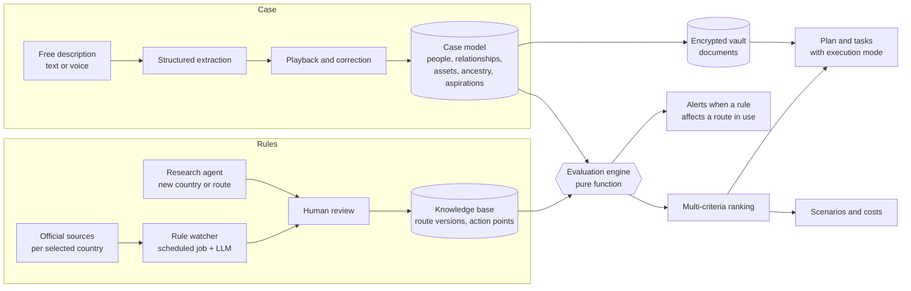

# Architecture

As of 2026-11-01. Stack: [ADR-0010](adr/0010-stack-revised.md).

## Overview

The center of Arca is the **evaluation engine**: it crosses a versioned catalog of routes with a structured model of the case. Rules are data with a source and a verification date, not code ([ADR-0002](adr/0002-rules-as-versioned-data.md)). AI agents sit around that core to understand the family, explain, write and research; they never decide eligibility.



The rule watcher never changes a rule on its own: it proposes, a person approves, and the engine re-evaluates routes in use.

## Platforms and code layout

One client serves every platform ([ADR-0005](adr/0005-platform-strategy.md)): a TypeScript single-page app that builds to a static bundle, wrapped by Capacitor on Android and iOS and by Tauri on desktop.

```text
apps/
  api/          versioned HTTP API (/v1), the only door to data and AI; background
                workflows (Vercel Workflows) live in api/src/workflows
  web/          the client: React SPA, installable PWA
  mobile/       Capacitor project wrapping apps/web (Phase 4 Android, Phase 5 iOS and iPadOS)
  desktop/      Tauri project wrapping apps/web (Phase 6, only if its gate passes)
packages/
  domain/       case model, evaluation engine, unit computation, ranking; pure TypeScript, no I/O
  api-contract/ Zod route definitions, OpenAPI export and the typed client derived from them
  ui/           components and design tokens
  i18n/         message catalogs (pt-BR first)
  platform/     capability ports and their adapters (web, capacitor, tauri)
  db/           Drizzle schema and migrations, role SQL, row-level security guard tests
tooling/        shared ESLint and TypeScript configs, security header policy, repository scripts
                (dependency-source, boundary, contract and bundle checks, migration runner)
```

Rules that keep every platform possible:

- **No business logic in the client.** The client renders, collects input and calls the API. Domain logic lives in `packages/domain` and runs on the server.
- **No server-rendering dependency.** The client must work as static files inside a native wrapper.
- **Native features only through `packages/platform`.** Ports for camera and document scanning, secure key storage, biometric unlock, notifications, file picking, sharing and deep links. Each runtime has an adapter; UI code checks capabilities, never the operating system.
- **One identity across platforms.** Passkeys use the production domain as relying-party ID from day one. Native apps call the platform passkey APIs through the `platform` port (not WebAuthn in the WebView) and are linked to the domain through `/.well-known/assetlinks.json` (Android) and `/.well-known/apple-app-site-association` with the `webcredentials` entitlement (iOS) ([web.dev](https://web.dev/articles/webauthn-rp-id), [ADR-0006](adr/0006-auth.md)).
- **Same URLs everywhere.** Deep links (App Links, Universal Links) map to the web app's paths.
- **Portable encryption.** The vault format is standard and documented; native keystores later wrap the same case keys.

| Capability port | Web adapter | Android adapter | iOS adapter | Desktop adapter |
| --- | --- | --- | --- | --- |
| Document capture | Camera capture and file input | ML Kit document scanner | VisionKit document scanner | File picker |
| Key storage | WebCrypto non-extractable keys | Android Keystore | Keychain and Secure Enclave | OS keychain |
| Biometric unlock | Passkey user verification | BiometricPrompt | Face ID or Touch ID | OS prompt where available |
| Notifications | Web Push | FCM | APNs | OS notifications |
| Receive shared files | Web Share Target (where supported) | Share-sheet intent | Share extension | Drag and drop |
| Deep links | URLs | App Links | Universal Links | Custom protocol |

## Data model

Entities, not final schema:

- `case`, `person`, `relationship`: the case as a graph of people and relationships (marriage, divorce, common-law union, parenthood, custody). Units are computed per route, not stored.
- `aspiration`: priorities, deal-breakers, budget, timeline, risk tolerance and preferred execution mode, per person.
- `country`, `destination_choice`: catalog countries and the ones each person selected, with priority and the stay-together constraint.
- `ancestor`: parents and grandparents with country, dates, naturalization and certificates.
- `route`, `route_version`: routes per country; declarative requirements, costs, dependents covered, `sourceUrl`, `verifiedAt`, effective dates.
- `action_point`: where each step happens (official link, phone, consulate by jurisdiction, partner by region).
- `evaluation`: person or unit × route version → status, missing requirements, estimated cost and time.
- `asset`, `sale`, `gift`, `fx_transfer`: the source-of-funds trail.
- `plan`, `task`, `task_dependency`: the executable plan, with the execution mode of each task.
- `document`: type, owner, validity, apostille, translation and a pointer to the encrypted file.
- `contact`, `rule_change`: external contacts; watcher proposals with diff and decision.
- `knowledge_item`: requirement, document, step, form, fee, deadline, common pitfall or interview question, each with source and verification date.

## Agents

Specialized agents work on the knowledge base and the case model:

| Agent | Responsibility |
| --- | --- |
| Consultant | Diagnosis, destination comparison, recommendation with pros and cons |
| Document specialist | Personalized checklist and review of each uploaded file |
| Writer | Cover letters, business plans, source-of-funds statements |
| Interviewer | Voice simulation of consular interviews |
| Watcher | Rule changes in the selected countries |
| Concierge | Arrival and settling in the destination |

**Golden rule:** no agent states a requirement that is not in the knowledge base with a source. When the base does not cover a question, the agent says it does not know and opens a research task, which enters the base only after human approval.

## AI stack

Each problem gets the right technique; an LLM never decides on its own what a rule is. Providers sit behind ports ([ADR-0004](adr/0004-ai-providers-behind-ports.md)).

| Kind of AI | Used for |
| --- | --- |
| Conversational LLM (Claude) | Free-form intake, explanations, guides, writing, on-call questions |
| Structured extraction (LLM with schema output) | Turning the free description into the case model; detecting what is missing |
| Deterministic rules engine | Eligibility and unit computation, auditable and testable |
| Retrieval with citations (RAG) | Answering from the knowledge base, always with a source |
| Multi-criteria optimization | Ranking route and country combinations by each person's weights and the family's constraints |
| Agents with web search | Researching a new country or route and proposing knowledge-base entries |
| Vision and OCR | Reading and checking uploaded documents |
| Speech | Spoken intake and interview simulation |
| Decision model (for example, TypeSafe Jev) | Choosing execution mode, triaging complications, classifying message intent and document type, cheap judge in the evaluation suite. Never rules, dates or arithmetic. Receives minimal fields only |
| Model routing | Fast, cheap models for extraction and classification; strong models for strategy |

## Quality

Quality is measured, not assumed. A suite of **synthetic cases** covers families of varied shapes (single person, couple with young children, divorced parents with shared custody, dependent elderly parents, previous visa refusal, assets held by an ex-spouse, the shape of case 1), each with a reviewed expected outcome: units per route, top recommendations, required documents and execution modes.

The suite runs on every change to a prompt, model, adapter or rule version, and blocks deploy when quality drops. Classifier outputs are scored on accuracy and calibration.

## Security

- Passwordless login (passkeys), with re-authentication to open the vault and for financial actions.
- Row-level security on every table with case data, scoped by case and person. Each unit's finances are visible to others only if the owner shares them.
- Client-side encryption for documents: each case has a data key wrapped by the users' keys; storage holds ciphertext. Trade-off: AI extraction runs only when the user opens a document and authorizes it.
- Two-person approval to change bank or exchange details.
- Append-only audit log of who viewed and changed what.
- No personal data in logs, URLs or error tracking; encrypted backups with tested restores.
- Data minimization in every third-party AI adapter.

## Data flows

Every service that touches Arca's data, and what it may receive. A new processor, or a new kind of data sent to an existing one, needs an update here and a security review.

| Service | Role | Receives | Location |
| --- | --- | --- | --- |
| Neon (Postgres) | Primary database | All case data, under forced row-level security | São Paulo (`sa-east-1`) |
| Vercel | Client hosting, API functions, Workflows | All case data in processing; the database owner connection string (used by the build, readable by running functions) and the runtime role passwords ([ADR-0012](adr/0012-automation-first-setup.md)); workflow run payloads holding identifiers only, with zero retention ([ADR-0009](adr/0009-background-jobs-guarantees.md)) | São Paulo (`gru1`) for functions, run payloads and queues; run metadata (names, statuses, timestamps, no personal data) is processed outside Brazil and kept up to one year |
| Anthropic (CI review) | Reviewer subagents in CI ([ADR-0011](adr/0011-reviewers-in-ci.md)) | Source code, diffs, file lists and file history (SHAs, dates, paths); never case data, pull request text or contributor emails | Vendor cloud, outside Brazil |
| AWS S3 | Document storage and off-vendor backups | Ciphertext only | São Paulo (`sa-east-1`) |
| AWS KMS | Field-encryption key wrapping | Data keys, never data | São Paulo (`sa-east-1`) |
| Anthropic (Claude) | LLM calls | Minimal fields per call; no names, document numbers or account numbers | Vendor cloud, outside Brazil |
| Document-reading vendor (`DocumentReader`) | OCR and document review | Full content of a document, only when its owner authorizes that document | Chosen by ADR; vendor cloud |
| Embedding vendor (`Embedder`) | Knowledge-base retrieval | Public knowledge-base text only | Chosen by ADR |
| Speech vendor (`SpeechToText`, `TextToSpeech`) | Voice intake and interview practice | Audio of the person speaking, only when they start a voice session | Chosen by ADR |
| TypeSafe (Jev), if adopted | Classification | Minimal fields per call, same rules as LLM calls | Vendor cloud, outside Brazil |
| Langfuse | LLM tracing | Metadata, scores and masked text; no case content | Vendor cloud, outside Brazil |
| Sentry | Errors and traces | Reports with personal data scrubbed | Vendor cloud, outside Brazil |
| Resend | Transactional email | Recipient address and message | Vendor cloud, outside Brazil |
| Web Push services, FCM, APNs | Notifications | Generic message text ("You have a new task"); no personal data | Browser and platform vendors |
