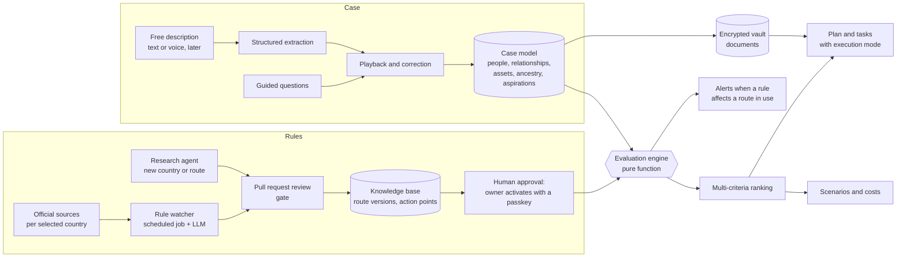

# Architecture

As of 2026-11-02. Stack: [ADR-0010](adr/0010-stack-revised.md).

## Overview

The center of Arca is the **evaluation engine**: it crosses a versioned catalog of routes with a structured model of the case. Rules are data with a source and a verification date, not code ([ADR-0002](adr/0002-rules-as-versioned-data.md)). AI agents sit around that core to understand the family, explain, write and research; they never decide eligibility.



The rule watcher never changes a rule on its own: it proposes, a person approves, and the engine re-evaluates routes in use. Route versions are JSON files in `packages/knowledge`, reviewed as pull requests and immutable once merged; a merged version stays proposed until the owner activates it in the app with a passkey ([ADR-0014](adr/0014-knowledge-base-as-reviewed-data.md), [spec 0002](specs/0002-rules-engine-and-knowledge-base.md)).

## Platforms and code layout

One client serves every platform ([ADR-0005](adr/0005-platform-strategy.md)): a TypeScript single-page app that builds to a static bundle, wrapped by Capacitor on Android and iOS and by Tauri on desktop.

```text
apps/
  api/          versioned HTTP API (/v1), the only door to data and AI; background
                workflows (Vercel Workflows) live in api/src/workflows
  web/          the client: React SPA, installable PWA
  mobile/       Capacitor project wrapping apps/web (Phase 4 Android, Phase 5 iOS and iPadOS)
  desktop/      Tauri project wrapping apps/web (Phase 6, only if its gate passes)
packages/
  domain/       case model, evaluation engine, unit computation, ranking; pure TypeScript, no I/O
  api-contract/ Zod route definitions, OpenAPI export and the typed client derived from them
  ui/           components and design tokens
  i18n/         message catalogs (pt-BR first)
  platform/     capability ports and their adapters (web, capacitor, tauri)
  db/           Drizzle schema and migrations, role SQL, the runtime role pool and request identity,
                the personal-data registry and the synthetic seed
  knowledge/    the knowledge base as data: route versions and their cases, country sets, official-domain
                lists and the countries files; validated, hashed and bundled into the API ([ADR-0014](adr/0014-knowledge-base-as-reviewed-data.md))
  telemetry/    the one scrubber every log, error, trace and LLM-trace exporter uses (ADR-0016)
  vault/        client-side document encryption in the age format (ADR-0018); never used by the API
tooling/        shared ESLint and TypeScript configs, security header policy, repository scripts
                (dependency-source, boundary and bundle checks, CI policy scripts, migration runner)
eval/           evaluation corpora: the synthetic families in families/ (spec 0002), later the synthetic AI
                evaluation suite
```

Rules that keep every platform possible:

- **No business logic in the client.** The client renders, collects input and calls the API. Domain logic lives in `packages/domain` and runs on the server. The one exception is end-to-end cryptography in `packages/vault` (encryption, sharing-state verification, recipient selection), which must run on the device; it holds no domain rules.
- **No server-rendering dependency.** The client must work as static files inside a native wrapper.
- **Native features only through `packages/platform`.** Ports for passkeys (and sealing or opening vault envelopes with them), camera and document scanning, secure key storage, notifications, file picking, sharing and deep links. Each runtime has an adapter; UI code checks capabilities, never the operating system.
- **One identity across platforms.** Passkeys use the production host as relying-party ID from day one (`arca.filx.app`; [ADR-0015](adr/0015-identity-enrollment-step-up-and-recovery.md)). Native apps call the platform passkey APIs through the `platform` port (not WebAuthn in the WebView) and are linked to the domain through `/.well-known/assetlinks.json` (Android) and `/.well-known/apple-app-site-association` with the `webcredentials` entitlement (iOS) ([web.dev](https://web.dev/articles/webauthn-rp-id), [ADR-0006](adr/0006-auth.md)).
- **Same URLs everywhere.** Deep links (App Links, Universal Links) map to the web app's paths.
- **Portable encryption.** The vault format is standard and documented; native keystores later wrap the same per-person vault identities ([ADR-0018](adr/0018-vault-encryption.md)).

| Capability port | Web adapter | Android adapter | iOS adapter | Desktop adapter |
| --- | --- | --- | --- | --- |
| Document capture | Camera capture and file input | ML Kit document scanner | VisionKit document scanner | File picker |
| Key storage | WebCrypto non-extractable keys | Android Keystore | Keychain and Secure Enclave | OS keychain |
| Notifications | Web Push | FCM | APNs | OS notifications |
| Receive shared files | Web Share Target (where supported) | Share-sheet intent | Share extension | Drag and drop |
| Deep links | URLs | App Links | Universal Links | Custom protocol |
| File picking | `<input type=file>` | Storage Access Framework | Document picker | OS file dialog |
| Sharing | Web Share API | Share sheet | Share sheet | OS share where available |
| Passkeys | WebAuthn | Credential Manager | Authentication Services | OS passkey APIs where available |
| Vault envelopes (passkey PRF, user-verified, biometric where the platform offers it) | WebAuthn PRF through `age-encryption` | Credential Manager PRF supplied to the same `age-encryption` code in the app's JavaScript runtime, else the recovery kit with the identity wrapped in Android Keystore | Authentication Services PRF supplied the same way, else the recovery kit with the identity wrapped in the Keychain | OS support where available, else the recovery kit |

Each port has one conformance suite in `packages/platform/src/conformance`, written once ([spec 0005](specs/0005-vault-devices-and-notifications.md#r5-platform-port-and-web-adapters) R5). Vitest runs every suite against in-memory fakes. Playwright runs it against the web adapters in Chromium, with pages served from the built package by request interception. A later Capacitor or Tauri adapter must pass the same suites.

- A port method called while its capability is missing rejects with `CapabilityUnavailableError`.
- `Capabilities.whyUnavailable()` says why a capability is missing: `unsupported`, or `needs-install` for web push before the app is installed.
- On the web, receiving shared files stays unavailable until the web app manifest declares a `share_target`.

## Data model

Entities, not final schema:

- `case`, `person`, `relationship`: the case as a graph of people and relationships (marriage, divorce, common-law union, parenthood, custody). Units are computed per route, not stored.
- `aspiration`: priorities, deal-breakers, budget, timeline, risk tolerance and preferred execution mode, per person.
- `country`, `destination_choice`: catalog countries and the ones each person selected, with priority and the stay-together constraint.
- `ancestor`: parents and grandparents with country, dates, naturalization and certificates.
- `route`, `route_version`: routes per country; declarative requirements, costs, dependents covered, `sources` (URL, kind, `verifiedAt`), effective dates, pinned country sets and official-domain lists. Files in `packages/knowledge`, not tables ([ADR-0014](adr/0014-knowledge-base-as-reviewed-data.md)); approvers' decisions on them are stored as the consultancy core's slice 3 specifies.
- `action_point`: where each step happens (official link, phone, consulate by jurisdiction, partner by region).
- `evaluation`: person or unit × route version → status, missing requirements, estimated cost and time.
- `asset`, `sale`, `gift`, `fx_transfer`: the source-of-funds trail.
- `plan`, `task`, `task_dependency`: the executable plan, with the execution mode of each task.
- `document`: type, owner, validity, apostille, translation and a pointer to the encrypted file.
- `contact`: external contacts. Watcher proposals are pull requests, activated or rejected by an approver (ADR-0014).
- `knowledge_item`: requirement, document, step, form, fee, deadline, common pitfall or interview question, each with source and verification date. Whether these and `action_point` are files like route versions is decided in consultancy core slice 5 (ADR-0014).

## Agents

Specialized agents work on the knowledge base and the case model:

| Agent | Responsibility |
| --- | --- |
| Consultant | Diagnosis, destination comparison, recommendation with pros and cons |
| Document specialist | Personalized checklist and review of each uploaded file |
| Writer | Cover letters, business plans, source-of-funds statements |
| Interviewer | Voice simulation of consular interviews |
| Watcher | Rule changes in the selected countries |
| Research agent | Proposes route versions from official sources when the base does not cover a question |
| Independent check | Compares each proposed version with its official sources, using a guide per country, and reports to the owner before activation; advisory only |
| Concierge | Arrival and settling in the destination |

Each agent gets only the tools its task needs, set in its definition. The research agent and the watcher read untrusted web pages, so they get a constrained fetch tool and one proposal tool that opens a pull request with new route versions and country sets, and nothing else: no shell, no case data, no merge, no official-domain lists, no approver list, no workflows ([ADR-0014](adr/0014-knowledge-base-as-reviewed-data.md#research-agents-required-properties)). The independent check gets the same fetch tool, limited to the version's sources and official hosts, and a report sink only; slice 2 places the country guides.

**Golden rule:** no agent states a requirement that is not in the knowledge base with a source. When the base does not cover a question, the agent says it does not know and opens a research task, which enters the base only after human approval.

## AI stack

Each problem gets the right technique; an LLM never decides on its own what a rule is. Providers sit behind ports ([ADR-0004](adr/0004-ai-providers-behind-ports.md)).

| Kind of AI | Used for |
| --- | --- |
| Conversational LLM (Claude) | Explanations, guides, writing, on-call questions |
| Structured extraction (LLM with schema output) | Turning the free description into a draft of the case model ([spec 0008](specs/0008-free-text-intake.md)); detecting what is missing |
| Deterministic rules engine | Eligibility and unit computation, auditable and testable |
| Retrieval with citations (RAG) | Answering from the knowledge base, always with a source |
| Multi-criteria optimization | Ranking route and country combinations by each person's weights and the family's constraints |
| Agents with web search | Researching a new country or route and proposing knowledge-base entries |
| Vision and OCR | Reading and checking uploaded documents |
| Speech | Spoken intake and interview simulation |
| Decision model (for example, TypeSafe Jev) | Choosing execution mode, triaging complications, classifying message intent and document type, cheap judge in the evaluation suite. Never rules, dates or arithmetic. Receives minimal fields only |
| Model routing | Fast, cheap models for extraction and classification; strong models for strategy |

## Quality

Quality is measured, not assumed. A suite of **synthetic cases** covers families of varied shapes (single person, couple with young children, divorced parents with shared custody, dependent elderly parents, previous visa refusal, assets held by an ex-spouse, the shape of case 1), each with a reviewed expected outcome: units per route, top recommendations, required documents and execution modes.

The suite runs on every change to a prompt, model, adapter or rule version, and blocks deploy when quality drops. Classifier outputs are scored on accuracy and calibration.

## Security

- Passwordless login (passkeys), invite-only, with purpose-bound step-up for sensitive and financial actions and a user-verified passkey ceremony to open the vault ([ADR-0015](adr/0015-identity-enrollment-step-up-and-recovery.md)); step-up also activates or rejects a knowledge-base version ([ADR-0014](adr/0014-knowledge-base-as-reviewed-data.md)).
- Row-level security on every table with case data, scoped by account and then by case membership (ADR-0008, ADR-0015). A person's profile and finances are visible only to their keeper and to the members the keeper shared them with ([spec 0007](specs/0007-case-model-and-guided-intake.md#r1-case-tables)).
- Client-side encryption for documents in the age format: each person has a hybrid post-quantum identity, kept on the server only inside envelopes their passkeys or recovery kit open; each document is encrypted to its owner and the people it is shared with; storage holds ciphertext ([ADR-0018](adr/0018-vault-encryption.md)). Trade-off: AI extraction runs only when the user opens a document and authorizes it.
- Two-person approval to change bank or exchange details.
- Append-only audit log of who viewed and changed what.
- No personal data in logs, URLs or error tracking; Neon's point-in-time restore as the backup ([ADR-0021](adr/0021-stay-on-vercel-and-neon.md)); retention per data type in [RETENTION.md](RETENTION.md).
- Data minimization in every third-party AI adapter.

## Data flows

Every service that touches Arca's data, and what it may receive. A new processor, or a new kind of data sent to an existing one, needs an update here and a security review.

| Service | Role | Receives | Location |
| --- | --- | --- | --- |
| GitHub (public repository) | Source, docs and knowledge data | Code and public rules ([ADR-0014](adr/0014-knowledge-base-as-reviewed-data.md)); no case data | Public |
| Neon (Postgres) | Primary database | All case data, under forced row-level security | São Paulo (`sa-east-1`) |
| Vercel | Client hosting, API functions, Workflows | All case data in processing; the database owner connection string (used by the build, readable by running functions) and the runtime role passwords ([ADR-0012](adr/0012-automation-first-setup.md)); workflow run payloads holding identifiers only, with zero retention ([ADR-0009](adr/0009-background-jobs-guarantees.md)) | São Paulo (`gru1`) for functions, run payloads and queues; run metadata (names, statuses, timestamps, no personal data) is processed outside Brazil and kept up to one year |
| Vercel Blob (private store) | Document storage ([ADR-0021](adr/0021-stay-on-vercel-and-neon.md)) | Client-side ciphertext only, under random pathnames | São Paulo |
| Anthropic (Claude) | LLM calls | Minimal fields per call; no names, document numbers or account numbers. Exception ([ADR-0023](adr/0023-free-text-intake-sends-the-writers-own-words.md)): free-text intake sends the member's own description, with known names, digit runs, mixed letter-and-digit tokens, e-mails and phone numbers masked; Arca stores nothing of it. Anthropic's API terms (read 2026-11-06): no training on API data by default ([Commercial Terms](https://www.anthropic.com/legal/commercial-terms) §B; [privacy center](https://privacy.claude.com/en/articles/7996868)); inputs and outputs deleted within 30 days, except content flagged for a usage-policy breach (up to 2 years), trust-and-safety scores (up to 7 years), feedback the account sends, or a legal hold ([retention](https://privacy.claude.com/en/articles/7996866)) | Vendor cloud, outside Brazil; the terms name no region |
| Document-reading vendor (`DocumentReader`) | OCR and document review | Full content of a document, only when its owner authorizes that document | Chosen by ADR; vendor cloud |
| Embedding vendor (`Embedder`) | Knowledge-base retrieval | Public knowledge-base text only | Chosen by ADR |
| Speech vendor (`SpeechToText`, `TextToSpeech`) | Voice intake and interview practice | Audio of the person speaking, only when they start a voice session | Chosen by ADR |
| TypeSafe (Jev), if adopted | Classification | Minimal fields per call, same rules as LLM calls | Vendor cloud, outside Brazil |
| Langfuse | LLM tracing, from the first model call | Metadata and scores; no prompt or completion text; no case content | EU region ([ADR-0016](adr/0016-observability-and-scrubbing.md)) |
| Sentry | Errors and traces | Reports scrubbed by `packages/telemetry`, with no account, case, document or session IDs; browser events and CSP violation reports (directive, reduced URLs, line and column) relayed and scrubbed again by our API; no source maps | United States (the owner's existing organization), kept 30 days ([ADR-0016](adr/0016-observability-and-scrubbing.md)) |
| Resend | Transactional email: the owner enrollment link, invites, recovery links, security notices | Recipient address and a generic message with one link | Sent from São Paulo (`sa-east-1`); account data, logs and metadata stored in the United States ([ADR-0015](adr/0015-identity-enrollment-step-up-and-recovery.md)) |
| Proton Mail (the owner's mailbox) | Replies to Arca's email, sent as `arca@filx.app` | Whatever a member writes in a reply, outside the vault; Arca itself sends nothing there | Switzerland |
| Browser push services: Google (FCM), Mozilla, Apple, Microsoft (WNS) | Push notifications (spec 0005 R7) | A message code and ID, encrypted to the browser's subscription and padded to a fixed size; the text is rendered on the device from our catalog. The service sees the subscription endpoint, our VAPID public key and the time of each push. The API posts only to these hosts | Browser and platform vendors |
